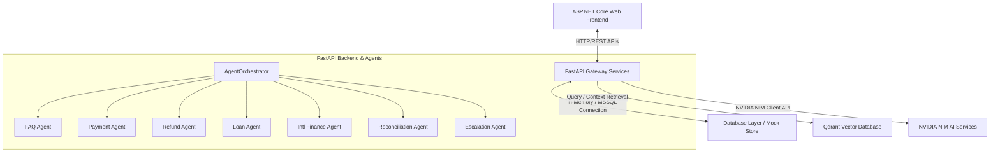
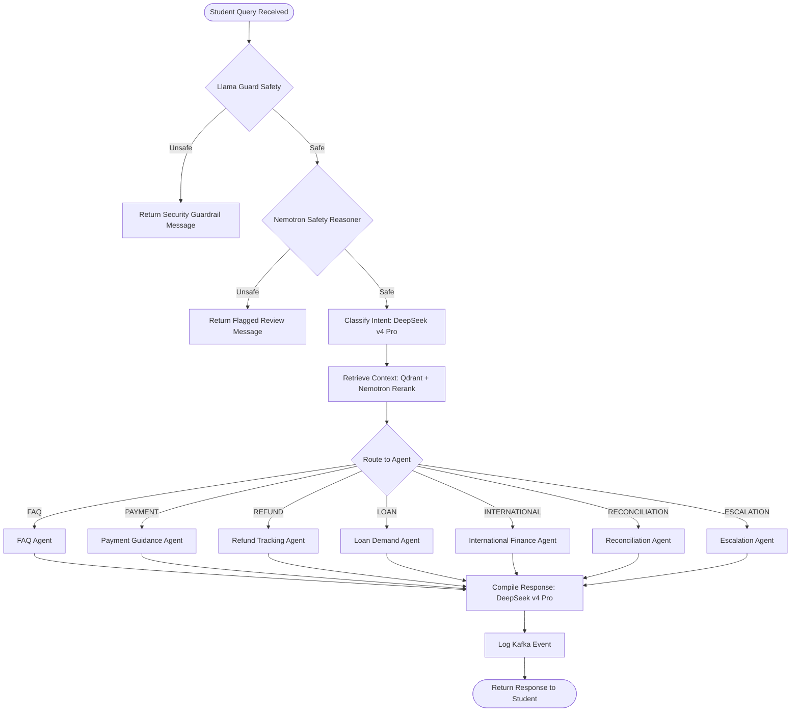

# system_architecture.md - FinVault System Architecture

This document provides a comprehensive overview of the architecture of the **FinVault Autonomous Student Finance Intelligence Platform**, details the components, and explains the Multi-Agent System (MAS) Directed Acyclic Graph (DAG) orchestrating student and admin transactions.

---

## Architecture Overview

FinVault uses a decoupled microservices architecture designed to demonstrate autonomous billing, reconciliation, RAG-augmented query processing, and student-support services. 

---

## Core Components

### 1. Frontend: ASP.NET Core Razor Pages
* **Role**: Serves the student portal dashboard, admin/officer reconciliation views, and approvals queue.
* **Technology**: C# Razor Pages, CSS, Javascript (`site.js`).
* **Interactions**: Executes RESTful API calls to the FastAPI gateway backend. It contains a dynamic client-side switcher allowing testers to seamlessly toggle between mock student personas (Arjun Shah in `INR` and Sarah Connor in `USD`) and updates currency formatting, labels, and forms in real-time.

### 2. Backend Gateway: FastAPI
* **Role**: Serves endpoints for student queries, payment processing, transaction log reconciliation, approvals/escalation queues, and certified document generation.
* **Technology**: Python, Uvicorn, FastAPI.
* **PDF Engine**: Uses `reportlab` to construct verified education loan demand letters in memory as dynamic PDFs.

### 3. Database Layer
* **Role**: Stores tables for Students, Ledger Balances, Invoices, Transactions, Refunds, and Exceptions.
* **Technology**: Supports both an in-memory Mock Database (`database_mock.py`) and a production MSSQL database (`database/MSSQL/schema.sql` via `pyodbc` connections).

### 4. Semantic Search (RAG Engine)
* **Role**: Stores financial guidelines, FAQs, SWIFT codes, and refund policies.
* **Technology**: Qdrant Vector Database (in-memory index) combined with NVIDIA embedding NIM models.

---

## Agent Orchestrator DAG Workflow

When a query is received at `/api/chat`, it runs through a sequential agent DAG emulating a LangGraph state machine:

1. **Safety Validation (Llama Guard 4)**: Filters out inappropriate queries or policy violations.
2. **Safety Reasoning (Nemotron Content Safety)**: Inspects query nuance to detect compliance and alignment risks.
3. **Intent Classification (DeepSeek v4 Pro)**: Determines the request intent and routes it into one of 7 financial domains (FAQ, PAYMENT, REFUND, LOAN, INTERNATIONAL, RECONCILIATION, ESCALATION).
4. **Context Retrieval (Qdrant + Nemotron Rerank)**: Ingests documents and retrieves relevant semantic chunks.
5. **Child Agent Execution (Nemotron Nano)**: Runs specialized execution logic based on intent (e.g. creating refund requests or loan demand letters).
6. **Final Compilation (DeepSeek v4 Pro)**: Assembles the response utilizing database facts and correct mathematical/currency figures.
7. **Kafka Event Log**: Publishes event telemetry (such as `agent-response-generated`, `payment-reconciled`, or `escalation-triggered`) to simulate message-queue systems.
